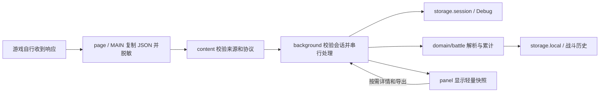

# 架构

本项目从 `gbf-solomonis-assist` 提取构建方式与运行时分层，重新实现监听 Debug，并将 Tarou 战斗逻辑适配为纯 TypeScript + React。模块对应关系见 [迁移说明](TAROU_MIGRATION.md)。

## 模块边界

| 模块 | 职责 |
| --- | --- |
| `page` | document_start 包装 fetch/XHR，默认关闭。只复制允许 origin 的 JSON；异常隔离，原请求和响应保持原样 |
| `content` | 校验同一 window、origin、channel 和 payload；传递 START/STOP 和 ready 握手，不接触业务 |
| `background` | 校验 sender、标签页和 sessionId；控制窗口和监听、串行状态读写、广播摘要，隔离战斗解析与 Debug 错误 |
| `panel` | 控制监听、筛选响应、查看战斗详情/历史，使用 Blob 本地导出 |
| `domain` | 不依赖 React、DOM 或 chrome API；模型、JSON 守卫、脱敏和预算 |
| `domain/battle` | 窄投影外部数据、scenario 统计、历史恢复校验、容量限制与导出 |
| `shared` | MAIN/content/runtime 消息联合类型及守卫 |

## 协议与生命周期

控制流：面板或扩展图标 → background → content → MAIN。数据流单向进入扩展，不存在游戏动作通道。

- 开始监听时校验来源 tab，并生成 sessionId。重复开始同一活动标签页会沿用会话。
- 请求发起时快照当前 sessionId；读取完毕时再确认相同会话。停用期间发起、停止后完成和跨会话的迟到响应不进入记录。
- 切换标签页先通知旧页停止，清空 Debug 并重置当前战斗关联，再启用新页；本地历史保留。后台拒绝旧 tab / sessionId 的消息。
- 停止监听时使 sessionId 失效，但保留来源 tab、当前详情与历史。
- content 主动查询与 MAIN ready 双重握手。content 使用控制版本防止旧握手覆盖刚收到的 STOP/START。
- Service Worker 唤醒时从 session 恢复并核验来源 tab，再独立恢复本地战斗历史；没有匹配来源时不恢复当前战斗关联。
- 来源 tab 关闭或离开允许域名后撤销关联，已有记录继续可查。
- 关闭面板不停止监听；扩展图标复用已有独立窗口。

所有后台控制、采集、查询与 tab 生命周期操作进入同一 promise 队列。单次操作失败不会使后续队列失效。`STATE_UPDATED` 只广播 Debug 元数据与最多 10 条战斗摘要，不携带正文、角色数组或行动明细。

详情与导出使用 `GET_CAPTURE` / `GET_CAPTURE_EXPORT`、`GET_BATTLE_RECORD` / `GET_BATTLE_EXPORT`。清空 Debug 与删除/清空战斗历史是独立操作，历史删除在面板确认后执行。

## 战斗处理

1. 收到允许域名、匹配来源和活动 session 的有效响应，后台再次脱敏并写 Debug。
2. `start.json` 建立 Raid ID 对应的战斗，包括 Boss、角色、前排位置和起始状态。相同 Raid ID 再次进入时合并状态，累计伤害保留，开幕行动不重计。
3. 行动响应按 scenario 顺序累计各角色伤害、承伤、技能/奥义次数及连击样本。承伤使用行动前阵型，状态效果使用响应后的阵型；未知归属单独累计。
4. 行动记入原回合，再根据 `status.turn` 创建新回合。只有响应明确给出的 Guard、奥义开关或行动信息才更新，缺失保留未知。
5. 多 Boss 分别更新 HP；只有最终 `win`、`lose` 或匹配结算响应才标记战斗结果。单个敌人死亡不等于整场胜利。
6. 保存本地历史，再发布摘要。解析或本地保存失败不会阻断 Debug，面板显示错误。

同一捕获消息以时间、路径和正文指纹去重；相同伤害数值的新响应仍计入。每场保留最近 256 个指纹。中途开始或刷新会标记统计可能不完整，不补发游戏请求。

## 信任与容量

MAIN 消息不可信，同源校验不构成真实性证明。content 与 background 都会确认捕获 URL 的 origin 和发送页面一致，防止两个允许域名之间伪造来源；background 只接收允许 origin 的 content sender 的采集消息，控制/导出请求只接收自身 panel 页面。外部 JSON 必须通过形状、深度和节点预算；后台重新脱敏并去除 URL 查询参数。sessionId 用于区分生命周期，不是页面无法读取的秘密。

| 数据 | 存储 | 限制 |
| --- | --- | --- |
| 脱敏响应 Debug | `storage.session` | 100 条、700 KiB；单条正文 512 KiB，超限仅元数据 |
| 派生战斗记录 | `storage.local` | 最近 10 场、总计 2 MiB；每场 200 回合、1000 条行动 |

战斗预算优先淘汰旧场次，再省略当前战斗旧回合/行动与状态明细，保留累计统计；异常的超大记录可被忽略。历史按 schemaVersion 与嵌套字段校验恢复，不接受外部导入。保存失败时仍使用内存状态实时展示，但后台重启后本次更新可能丢失。

记录只保存战斗投影，主人公名称固定，参战者不保存用户 ID 或昵称。不会写入账号资料、请求体、请求头、Cookie、真实账号 fixture 或网络上报。面板静态图片仅允许源项目使用的游戏 CDN，代码与网络连接仍受 CSP 限制。

## 验证

`npm run check` 执行人工样本测试、TypeScript 检查和生产构建，覆盖采集透传/脱敏/生命周期，以及战斗分类统计、换位、多段承伤、刷新合并、多 Boss、结果标记、历史预算/恢复/导出、后台完整链路和 React 静态渲染。测试不访问游戏。

浏览器手工验收：

1. 加载 `dist/`，确认无 Manifest / Service Worker 错误；刷新游戏页，从扩展图标打开面板。
2. 开始监听后进入/刷新战斗页，确认“战斗详情”初始化；手动使用技能、召唤和攻击，检查分类伤害、承伤、回合及状态变化。
3. 切换详情子页和历史记录，检查单场/全部 JSON 导出；确认无指纹、参战者用户标识或昵称。
4. 刷新游戏页，确认同一战斗累计不归零、不重复累计开幕伤害，并提示缺失风险。
5. 停止监听后手动操作，记录不再增加；重新开始仅统计新会话响应。切换来源清空 Debug、等待新战斗，历史保留。
6. Debug 筛选、详情、导出、清空正常；清空 Debug 后战斗历史仍可查看。
7. 关闭来源或跳转到其他域名后停止；浏览器重启后 Debug 为空，战斗历史仍存在，可删除/清空。
8. 在宽/窄窗口检查详情表格、记录列表和行动明细，以及静态图片不可用时的占位。

自动测试与构建通过不等于已在真实游戏环境完成上述验收。
